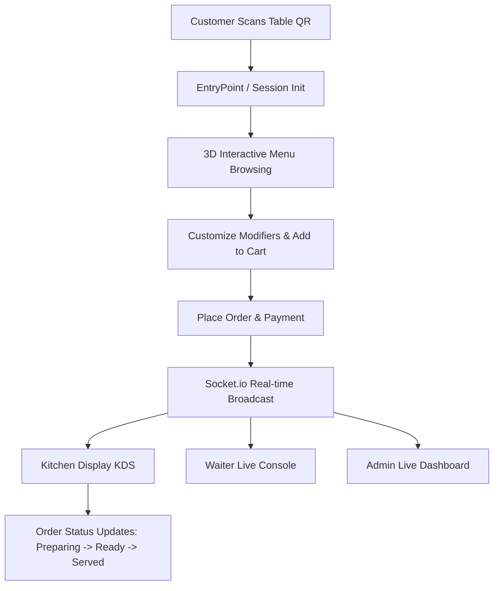

# 🍽️ Smart Restaurant 3D – Complete Tech Stack & Workflow Progress Document

---

## 📌 Executive Summary
**Smart Restaurant 3D** is an end-to-end, full-stack, contactless smart dining and restaurant management system. The platform bridges the customer dining experience with restaurant operations through **secure QR code table ordering**, **interactive WebGL Three.js 3D food and floorplan visualizers**, a **real-time Kitchen Display System (KDS)**, **waiter stations**, and a **data-driven administrative suite**.

The application features a **Dual-Mode Architecture**:
1. **Full-Stack Enterprise Mode**: Runs with Node.js/Express, PostgreSQL (Prisma ORM), Redis caching, Socket.io real-time websockets, and Cloudinary media storage.
2. **Resilient Standalone / Offline Demo Mode**: Seamlessly activates when backend/database services are offline, utilizing local storage persistence and mock data engines so testing, client demos, and static deployments (like Netlify) function flawlessly without crashing.

---

## 💻 1. Complete Technology Stack

### 🎨 Frontend (Client-Side)
| Category | Technology | Version | Purpose & Implementation Details |
| :--- | :--- | :--- | :--- |
| **Core Framework** | **React** | `18.2.0` | Component-based UI with hooks, context, and modern React 18 concurrent rendering. |
| **Language** | **TypeScript** | `5.3.3` | End-to-end type safety across components, props, models, and API responses. |
| **Build & Bundler** | **Vite** | `7.3.0` | Ultra-fast HMR development server and production Rollup bundling. |
| **Styling & Design** | **Tailwind CSS** | `4.1.18` | Modern CSS styling with futuristic glassmorphism, dark/light themes, and custom gradients. |
| **Icons** | **Lucide React** | `0.562.0` | High-fidelity UI icons for restaurant operations, actions, and status badges. |
| **3D Graphics & WebGL** | **Three.js** | `0.186.1` | Native WebGL rendering: Interactive 3D dish inspector, 3D culinary hero background, and 3D floor plan. |
| **Motion & Micro-interactions** | **Framer Motion** | `12.25.0` | Smooth page transitions, sliding drawer navigation, and cart bounce animations. |
| **State Management** | **Zustand** & **Redux Toolkit** | `4.5.7` / `1.9.7` | Lightweight client state for cart, orders, and user sessions. |
| **Local Persistence** | **Browser LocalStorage API** | Native | Automatic JSON storage for newly added menu items, custom photos, and offline menu editing. |
| **Data Visualization** | **Recharts** & **Chart.js** | `2.7.2` / `4.4.1` | Analytical charts for revenue timelines, top-selling dishes, and payment breakdowns. |
| **QR Code Generation** | **qrcode.react** | `4.2.0` | Dynamic SVG/Canvas QR code rendering for table identification. |
| **QR Code Scanner** | **html5-qrcode** | `2.3.8` | Real-time device camera scanner for scanning table QR tokens directly on mobile. |
| **Document & Media Export** | **jsPDF** & **html2canvas** | `4.0.0` / `1.4.1` | One-click table QR export to high-resolution print-ready PDF and PNG. |
| **HTTP & API** | **Axios** | `1.13.2` | Configured with automatic bearer token interceptors and silent offline fallback handlers. |
| **Real-time Client** | **Socket.io Client** | `4.7.2` | Bi-directional websocket connection for live order updates. |
| **Payments** | **Stripe React SDK** | `5.4.0` / `8.6.0` | Credit card checkout form integration. |
| **Notifications & Dialogs** | **react-hot-toast** & **SweetAlert2** | `2.6.0` / `11.26.17` | Sleek toast alerts and interactive confirmation modals. |

---

### ⚙️ Backend (Server-Side)
| Category | Technology | Version | Purpose & Implementation Details |
| :--- | :--- | :--- | :--- |
| **Runtime Environment** | **Node.js** | `v20.x` | Asynchronous, event-driven server runtime. |
| **Language** | **TypeScript** | `5.3.3` | Strong typing, interfaces, and compile-time verification for server code. |
| **Web Framework** | **Express.js** | `4.18.2` | RESTful API server routing, middleware handling, and modular architecture. |
| **Database** | **PostgreSQL** | `15.0` | Relational database handling tables, menu items, orders, users, payments, and sessions. |
| **ORM** | **Prisma ORM** | `5.22.0` | Declarative schema migrations, type-safe queries, and seed scripts. |
| **Caching & In-Memory Store** | **Redis** | `7.0` | High-speed cache for session state & tokens, backed by automatic in-memory fallback. |
| **Websockets & Live Events** | **Socket.io** | `4.7.2` | Real-time events between customer, kitchen (KDS), and waiter panels. |
| **Auth & Security** | **Passport.js & JWT** | `0.6.0` / `9.0.0` | JWT token authentication, refresh tokens, Google OAuth 2.0, and bcrypt password hashing. |
| **Request Validation** | **Zod** | `4.3.5` | Strict schema validation for incoming payloads. |
| **File & Image Uploads** | **Cloudinary** & **Multer** | `2.9.0` / `2.0.2` | Cloud storage for food images with JPEG/PNG/WebP format handling. |
| **QR Code Processing** | **qrcode** & **jsqr** | `1.5.4` / `1.4.0` | Server-side QR token creation and validation. |
| **Export Utilities** | **Archiver** | `7.0.1` | Bulk zip packaging for downloading all table QR codes simultaneously. |
| **Email Service** | **Nodemailer** | `7.0.12` | SMTP email dispatch for account verification and password reset. |

---

### 🚢 DevOps, Hosting & Networking
| Tool / Platform | Role & Configuration |
| :--- | :--- |
| **Docker & Docker Compose** | Multi-container setup orchestrating PostgreSQL, Redis, Backend, and Frontend. |
| **Netlify** | Production static web hosting configured with `netlify.toml` and `_redirects` for SPA routing. |
| **Localtunnel (`loca.lt`)** | Secure HTTPS reverse-tunnel for instant live mobile device testing on local development servers. |
| **Git & GitHub** | Source code management with branch version control. |

---

## 🔄 2. Workflows Completed Till Now

---

### 📱 Workflow A: Contactless QR Dine-in & Customer Ordering
1. **Cryptographically Signed QR Codes**:
   - Each table has a unique QR code encoded with a secure, version-controlled token (`?tableId=xxx&token=yyy`).
   - If an admin regenerates a table's QR code, previous codes are instantly invalidated for security.
2. **Scanner & Entry Gate**:
   - Customers can scan the physical QR using their native phone camera or the built-in HTML5 in-app scanner.
   - The app verifies the token and initializes an active `TableSession`.
3. **Menu Exploration & Filtering**:
   - Categorized browsing (Chef Specials, Gourmet Burgers, Pizza, Asian, Beverages).
   - Instant search and sorting by price/name.
4. **Interactive 3D Dish Showcase**:
   - Customers can open dishes in a **Three.js 3D Viewer** to inspect food geometry in 360°, inspect textures, and observe realistic lighting/steam particles.
5. **Item Customization & Cart**:
   - Modifier selection (Spiciness, Add-ons, portion sizes).
   - Real-time cart calculations and instant order submission.

---

### 👨‍🍳 Workflow B: Kitchen Display System (KDS) & Waiter Management
1. **Live Ticket Pipeline**:
   - Orders appear in the kitchen dashboard segmented by status:
     - `RECEIVED` ➡️ `PREPARING` ➡️ `READY` ➡️ `SERVED` ➡️ `COMPLETED`.
2. **Prep-Time Monitoring**:
   - Color-coded tickets (Green, Yellow, Red) based on preparation time thresholds.
3. **Waiter Station**:
   - Real-time waiter table notifications, assistance call tracking, and delivery confirmations.

---

### 📊 Workflow C: Administrator Suite & Analytics
1. **Mobile-First Futuristic Redesign**:
   - Fully optimized mobile interface featuring a floating bottom navigation dock, horizontal tab pills, and a slide-in quick drawer.
   - Completely resolved mobile layout overflow and cluttered tabs.
2. **Menu & Photo Management**:
   - Full CRUD operations: Create, update, or remove menu items with preparation time, price, tags, and modifier sets.
   - Supports JPEG, PNG, and WebP image uploads.
   - Dual-mode synchronization: Saves to database when connected, or falls back to local storage so items like "Vada Paav" remain permanently saved in the browser across refreshes.
3. **Table & QR Administration**:
   - Table capacity and status management.
   - Single-table and bulk "Regenerate All QR" operations.
   - Export individual or all table QR codes as professional **PDF** or high-res **PNG**.
4. **Analytics & Performance Tracking**:
   - Key business metrics: Gross Revenue, Order Volume, Active Guests.
   - Interactive charts for hourly revenue trends, top-selling dishes, and payment breakdowns.

---

### 🛡️ Workflow D: High Availability & Deployment Readiness
1. **Offline & Standalone Fallback Engine**:
   - When the backend or database is offline, frontend API calls automatically catch exceptions and redirect to an in-memory & `localStorage` mock dataset.
   - Eliminates broken UI states and enables presentation-ready standalone demonstrations.
2. **Production Build Validation**:
   - The Vite production build compiles with zero TypeScript or asset bundling errors.
   - Assets are compiled to `frontend/dist/` with SPA fallback redirects (`/* /index.html 200`).
3. **Public Deployment Ready**:
   - Tested for Netlify manual drag-and-drop deployment.
   - Verified for mobile testing via Localtunnel (`loca.lt`).

---

## 🎯 3. What's Next / Future Roadmap
1. **Cloud Database & Backend Hosting**: Deploying PostgreSQL and the Node.js API to Render/Railway for synchronized live data across different devices.
2. **Real Payment Gateway Activation**: Connecting live Stripe and mobile wallet keys (Apple Pay / Google Pay).
3. **Automated CI/CD**: Setting up GitHub Actions for continuous deployment on push to `main`.
